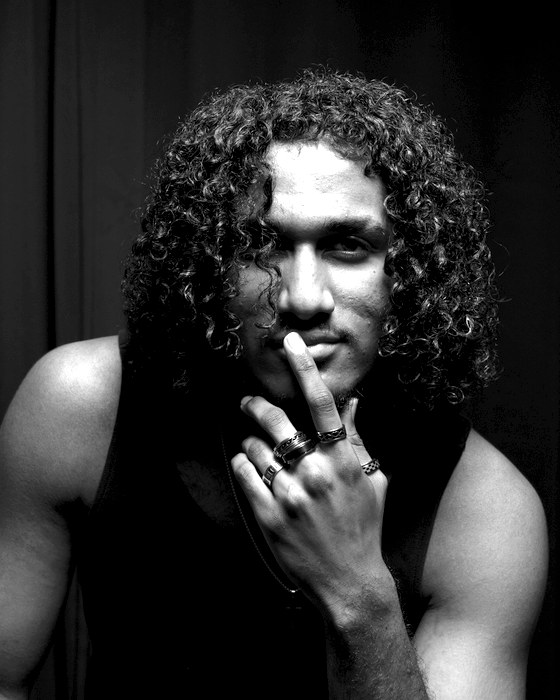

  
  
  
  
  
  
  
  
  
  

<table>
<tr>
<td valign="top">

## Yo, I'm Sameer, aka RETRO

Software engineer, creative director and now **open to modeling work**. I build and ship production software and AI systems, run **Retro Studios**, and release music as RETRO. I measure first, keep a fallback for every failure and verify with data instead of trusting a report.

**In plain English:** I make software that works for real people on bad internet, I test it honestly, and I plan for the day something breaks.

Born in Monrovia, Liberia. Studied the IB in Israel. Now based in **Beppu, Japan** (JST), studying finance at APU and open to new contract work.

</td>
<td width="300" valign="top"></td>
</tr>
</table>

## Now

- **Taking new contract work.** My **Stick'Em** contract ended in September and **Ajiwow** wraps in November, so I have open capacity now and more from then.
- **Stick'Em** (Singapore EdTech, 2025 Hult Prize Global winner), contract software engineer, May to Sep 2026. Rebuilt slide delivery for classrooms in Brunei and the Philippines: about **15x faster on Slow-3G** (678 ms vs 10 s+), with the old iframe kept as an automatic fallback.
- **Ajiwow** (Tokyo food-tech, Techstars Tokyo 2026), freelance creative technologist, Sep 30 to Nov 2026. Brand system, a bilingual site on Azure with push-to-deploy, a print pipeline and video direction.
- **Founder of Retro Studios** under StarLabs, and **B.B.A. in Finance at APU**, Beppu. 1st place at the APU Annual Hackathon 2025 and Hult Prize APU runner-up with Best Speaker.

## Shipping log

Every repo below, sorted by the last time I pushed to it.

| Repo | What it is | Stack |
|---|---|---|
| [**portfolio**](https://github.com/sameermotwani17-cell/portfolio) | This whole portfolio: a tech side and a creative side, with case files, a showroom and a CV. | Next.js, TypeScript, Tailwind |
| [**miru-backend**](https://github.com/sameermotwani17-cell/miru-backend) and [**miru-frontend**](https://github.com/sameermotwani17-cell/miru-frontend) | MIRU, a voice AI interview coach for foreigners job-hunting in Japan. Bronze at a 15-team hackathon. | Next.js 16, FastAPI, Postgres |
| [**millennium-hall-booking**](https://github.com/sameermotwani17-cell/millennium-hall-booking) | Seat booking for AFRO WEEK 2026: 732 seats in live availability, QR e-tickets, a door scanner. | Next.js 14, Supabase |
| [**too-easy**](https://github.com/sameermotwani17-cell/too-easy) | A streetwear site built on restraint: five pieces, one grid. | HTML, CSS |
| [**akamatsu-system**](https://github.com/sameermotwani17-cell/akamatsu-system) | Bilingual e-commerce for a Japanese organic store, with pickup, delivery and an owner admin. | Next.js 16, Supabase |
| [**sgm-group-of-companies**](https://github.com/sameermotwani17-cell/sgm-group-of-companies) | An installable parts marketplace for a Liberian company, priced in LRD and USD. | Next.js 14, PWA |
| [**mamba-point-hotel**](https://github.com/sameermotwani17-cell/mamba-point-hotel) | A cinematic luxury hotel demo with zero dependencies. | Vanilla JS |
| [**retro_github_agent**](https://github.com/sameermotwani17-cell/retro_github_agent) | Manage any GitHub repo by sending one sentence to an n8n webhook. | n8n, Claude Code, Express |

## Case files

The longer write-ups live on the portfolio, each with the problem, constraints, approach, decisions and result.

| | Build | Headline |
|---|---|---|
| 01 | [Stick'Em SlideViewer](https://portfolio-sameermotwani17-cells-projects.vercel.app/tech#builds) | 678 ms vs 10 s+ on Slow-3G, with a fallback for every failure |
| 02 | [Ajiwow site and pipelines](https://portfolio-sameermotwani17-cells-projects.vercel.app/tech#builds) | Astro on Azure, push-to-deploy, a 31-point print check |
| 03 | [SCRAPYARD](https://portfolio-sameermotwani17-cells-projects.vercel.app/tech#builds) | A multiplayer shooter from a 200-line spec in one day, 91 tests |
| 04 | [AI Hack 2026](https://portfolio-sameermotwani17-cells-projects.vercel.app/tech#builds) | AUC 0.7635, Kyoto finalist, the only all-freshman team |
| 05 | [Curriculum engine](https://portfolio-sameermotwani17-cells-projects.vercel.app/tech#builds) | An AI that picks from a list and never invents a standard |
| 06 | [GOMI Snap](https://portfolio-sameermotwani17-cells-projects.vercel.app/tech#builds) | 520+ organic users, 95.3% adoption intent (n=400) |

## Stack

## Recognition

- **AI Hack 2026**, Kyoto finalist, top 8 nationwide, the only all-freshman team
- **Hult Prize APU Campus Round 2026**, 1st runner-up and Best Speaker
- **Kyutech x Science Tokyo x APU Hackathon 2026**, Bronze for MIRU
- **APU Annual Hackathon 2025**, 1st place for GOMI Snap

## Work with me

Contract and freelance: software engineering, AI-first builds and agents, clipping and short-form, and brand-plus-build launches. Part-time, remote worldwide or Japan. Also open to modeling work.

[**Pitch me a project**](mailto:sameermotwani17@gmail.com?subject=Project) · [How I work](https://portfolio-sameermotwani17-cells-projects.vercel.app/tech#hire) · [Modeling book](https://portfolio-sameermotwani17-cells-projects.vercel.app/creative#modeling)
